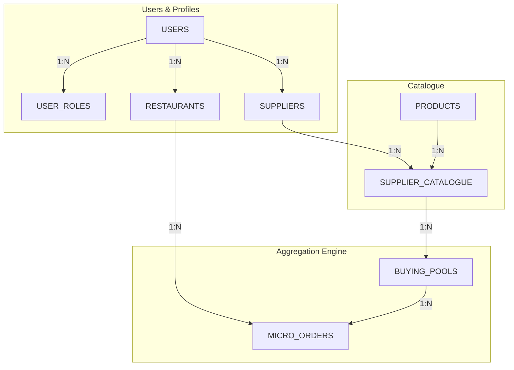

# CoBuy — B2B Group-Buying Platform for Cloud Kitchens

> **A collaborative procurement platform enabling independent cloud kitchens within a 5 km cluster to pool their ingredient orders and collectively unlock wholesale Minimum Order Quantities (MOQ).**

---

## 📖 Table of Contents
1. [What is CoBuy? (The 2-Minute Summary)](#1-what-is-cobuy-the-2-minute-summary)
2. [How It Works in Real Life (The Tomato Walkthrough)](#2-how-it-works-in-real-life-the-tomato-walkthrough)
3. [Domain Glossary](#3-domain-glossary)
4. [System Architecture & End-to-End Workflow](#4-system-architecture--end-to-end-workflow)
5. [Database Design (The 8 Relations)](#5-database-design-the-8-relations)
6. [Critical Engineering Rules & Viva Insights](#6-critical-engineering-rules--viva-insights)
7. [Repository Layout & Ownership](#7-repository-layout--ownership)
8. [Project Boundaries & Future Extension Points](#8-project-boundaries--future-extension-points)
9. [Developer Quickstart & Onboarding](#9-developer-quickstart--onboarding)

---

## 1. What is CoBuy? (The 2-Minute Summary)

If you run an independent cloud kitchen, wholesale suppliers won't sell to you at bulk discount rates unless you purchase enormous quantities (e.g., 500 kg of produce). If you buy that much alone, your working capital is tied up and food spoils. If you buy from retail vendors instead, your ingredient costs are 30–40% higher.

**CoBuy solves this through localized group buying:**
- Nearby kitchens (within a **5 km radius**) join collective **Buying Pools** for specific wholesale supplier offers.
- Kitchens pledge **Micro-Orders** (e.g., 150 kg or 200 kg).
- Once the collective sum reaches the supplier's MOQ, the pool is fulfilled and ready for procurement.

```
       [ Kitchen A: 200 kg ]
                 \
       [ Kitchen B: 150 kg ] ---> [ CoBuy Buying Pool ] ---> Meets 500 kg MOQ!
                 /                 (Status: FULFILLED)       (Supplier wholesale unlocked)
       [ Kitchen C: 150 kg ]
```

---

## 2. How It Works in Real Life (The Tomato Walkthrough)

To understand how the codebase works, follow this standard scenario:

1. **Supplier Lists an Offer:** "Fresh Foods" lists Tomatoes at **₹20/kg** with a Minimum Order Quantity (**MOQ**) of **500 kg**. This offer is saved in `SUPPLIER_CATALOGUE`.
2. **Buying Pool is Created:** A buying pool (`BP01`) is opened for this offer, anchored at a specific geographic center point (`geographic_zone`).
3. **Discovery:** Cloud kitchens within a 5 km radius search for active pools near their coordinates.
4. **Kitchens Place Micro-Orders:**
   - **Kitchen A** pledges **200 kg** (₹4,000). Current total: 200/500 kg. Status: `ACTIVE`.
   - **Kitchen B** pledges **150 kg** (₹3,000). Current total: 350/500 kg. Status: `ACTIVE`.
   - **Kitchen C** pledges **150 kg** (₹3,000). Current total: 500/500 kg.
5. **Target Reached:** As soon as Kitchen C's order commits, the system automatically transitions the pool status from `ACTIVE` to `FULFILLED`.

---

## 3. Domain Glossary

When reading the code and schema, you will encounter these specific terms:

| Term | Definition in CoBuy |
|---|---|
| **Cloud Kitchen** | A commercial kitchen that prepares food exclusively for delivery, registered as a `RESTAURANT`. |
| **MOQ** | **Minimum Order Quantity** — the smallest volume a wholesale supplier agrees to sell in a single bulk deal. |
| **Buying Pool** | A time-limited collective purchasing container tied to a single supplier-catalogue offer and a geographic zone. |
| **Micro-Order** | A single restaurant's individual contribution (requested quantity + pledged amount) to a specific buying pool. |
| **5 km Radius** | The geographic eligibility threshold. Restricting participants to 5 km ensures local aggregation is logistically viable for cluster delivery. |
| **Pledged Amount** | The financial liability committed by a restaurant: $\text{Requested Qty} \times \text{Price Per Unit}$. |

---

## 4. System Architecture & End-to-End Workflow



### Complete Operational Lifecycle:
1. **Authentication:** Users register and receive a JWT. Users are assigned roles (`restaurant_owner` and/or `supplier`) via `USER_ROLES`.
2. **Profiles:** Restaurant owners configure their kitchen location (`POINT SRID 4326`); suppliers configure their warehouse location and contact info.
3. **Offer Creation:** Suppliers select products and set `price_per_unit` and `min_order_qty` in `SUPPLIER_CATALOGUE`.
4. **Pool Discovery:** Kitchens query pools within 5 km using MySQL's spatial formula:
   ```sql
   ST_Distance_Sphere(restaurant.location_coord, pool.geographic_zone) <= 5000
   ```
5. **Atomic Order Placement:** Micro-orders are processed inside a database transaction:
   - Verify pool is `ACTIVE` and not expired.
   - Insert row into `MICRO_ORDERS`.
   - Atomically increment `buying_pools.current_qty`.
   - If `current_qty >= target_moq`, flip status to `FULFILLED`.

---

## 5. Database Design (The 8 Relations)

The schema is in Boyce-Codd Normal Form (BCNF) across 8 tables:

| Table | Primary Key | Purpose | Key Relationships / Constraints |
|---|---|---|---|
| **`USERS`** | `user_id` (UUID) | System authentication & credentials | Unique `email` & `username`. |
| **`USER_ROLES`** | `(user_id, role_name)` | Maps users to permissions | Composite PK; FK to `USERS` with `ON DELETE CASCADE`. |
| **`RESTAURANTS`** | `restaurant_id` (UUID) | Cloud kitchen information | FK `owner_id -> USERS(user_id)`. Stores `POINT SRID 4326`. |
| **`SUPPLIERS`** | `supplier_id` (UUID) | Supplier company information | FK `user_id -> USERS(user_id)` (links login to profile). |
| **`PRODUCTS`** | `product_id` (UUID) | Generic product catalog | Stores product name & unit of measure (e.g. kg, litre). |
| **`SUPPLIER_CATALOGUE`** | `catalogue_id` (UUID) | Junction table: Suppliers $\leftrightarrow$ Products | Enforces `UNIQUE(supplier_id, product_id)`. Stores unit price & MOQ. |
| **`BUYING_POOLS`** | `pool_id` (UUID) | Active group-buying opportunities | FK to `SUPPLIER_CATALOGUE`. Tracks `current_qty`, `target_moq`, status. |
| **`MICRO_ORDERS`** | `order_id` (UUID) | Individual kitchen contributions | FK to `BUYING_POOLS` & `RESTAURANTS`. Enforces `UNIQUE(pool_id, restaurant_id)`. |

---

## 6. Critical Engineering Rules & Viva Insights

If you are joining or reviewing this codebase, be aware of these foundational decisions:

1. **Why `DECIMAL(10,2)` for all numbers?**
   Floating-point types (`FLOAT`/`DOUBLE`) introduce binary precision errors (e.g. ₹0.10 + ₹0.20 becoming ₹0.30000000004). All money and quantities strictly use fixed-precision `DECIMAL(10,2)`.
2. **Why `POINT SRID 4326` and `ST_Distance_Sphere`?**
   Coordinates are stored using the global WGS 84 GPS standard. Distance is computed on a spherical model of the Earth (great-circle distance in metres), preventing flat-plane Euclidean distortion.
3. **Why Single Micro-Order per Kitchen per Pool?**
   `UNIQUE(pool_id, restaurant_id)` guarantees one kitchen cannot place competing duplicate orders in the same pool. Quantity changes are handled as updates.
4. **Why Transactions for Micro-Orders?**
   If two kitchens place orders simultaneously, a naive read-then-write approach causes the **lost update anomaly**. Database transactions with row-level locks guarantee atomic updates to `buying_pools.current_qty`.
5. **Why `ON DELETE RESTRICT`?**
   Parent records (users, restaurants, products, catalogue entries) cannot be deleted if active orders or pools exist. This preserves financial and audit history.

---

## 7. Repository Layout & Ownership

The project is built by a team of 3 with strict folder and module ownership:

```
CoBuy/
├── README.md                      # This onboarding guide
├── docs/
│   ├── PROJECT_CONTEXT.md         # Source of truth: Problem, ER, DFD, Normalization, Viva prep
│   ├── DECISIONS.md               # Architectural & engineering decisions log
│   ├── DAILY_LOG.md               # Daily engineering progress and cross-team sync
│   └── API_CONTRACT.md            # REST API endpoint specifications
├── src/                           # Source code (modularized by ownership)
│   ├── db/                        # [Dhruv] Connection pool, DDL, migrations, constraints
│   ├── auth/                      # [Dhruv] Registration, login, JWT verification, role guards
│   ├── profiles/                  # [Dhruv] Restaurant & Supplier profile management
│   ├── catalogue/                 # [Shaaz] Product & Supplier catalogue management
│   ├── pools/                     # [Shaaz] Buying pool lifecycle, status logic, 5 km queries
│   ├── aggregation/               # [Shaaz] Micro-orders, atomic transactions, quantity pooling
│   └── client/                    # [Debangshu] Frontend dashboards, UI progress bars, order forms
```

## 8. Project Boundaries & Future Extension Points

To maintain academic rigor and adhere to strict scope guidelines, the following are **intentionally not implemented**:
- **Payment Gateway:** Pledged amounts and payments are tracked using `payment_status` (`PENDING`, `PAID`). Real payment gateways (e.g. Razorpay, Stripe) are out of scope.
- **Refunds:** If a pool expires without meeting MOQ, the schema can mark it `EXPIRED`, but automatic financial reversals are not handled.
- **Supplier Dispatch & Logistics:** Tracking driver GPS, dispatch confirmation, and physical fulfillment are out of scope.
- **Supplier Payouts:** Disbursing pooled funds to supplier bank accounts is out of scope.

### How to Extend CoBuy in the Future:
If you are picking up this project to build on top of it:
- Add a `PAYMENT_TRANSACTIONS` table linking to `MICRO_ORDERS` to record gateway webhooks and refunds.
- Add an `INVOICES` or `PURCHASE_ORDERS` table linking fulfilled `BUYING_POOLS` to suppliers for dispatch tracking.

---

## 9. Developer Quickstart & Onboarding

### Prerequisites
- **Node.js** (v18.x or v20.x LTS)
- **MySQL Server** (v8.0+) with spatial support enabled

### Local Setup
```bash
# 1. Clone the repository
git clone <repo-url>
cd CoBuy

# 2. Configure Environment Variables
# Create a .env file with your local MySQL credentials:
# DB_HOST=localhost
# DB_PORT=3306
# DB_USER=root
# DB_PASSWORD=your_password
# DB_NAME=cobuy_db
# JWT_SECRET=your_jwt_secret_key
# PORT=5000

# 3. Read the documentation before contributing!
# Always review docs/DECISIONS.md and docs/API_CONTRACT.md first.
```
