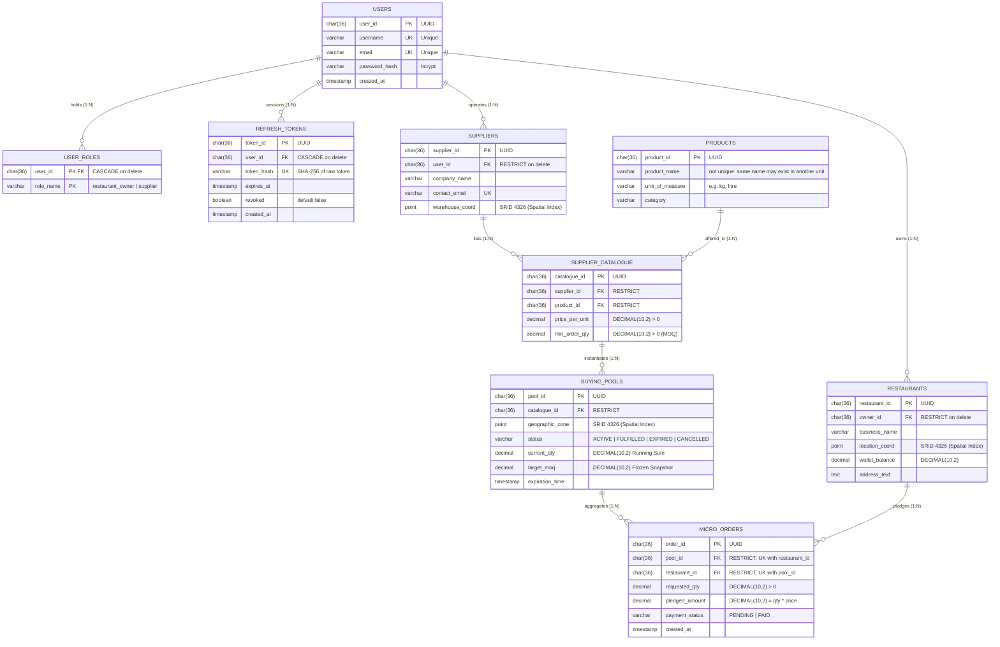

# CoBuy — Final Entity-Relationship (ER) Specification & Schema Defense

> **Owner:** Debangshu (Frontend Lead)  
> **Source of Truth:** Redrawn directly from [`src/db/schema.sql`](../src/db/schema.sql) (MySQL 8.0+ InnoDB DDL)  
> **Normalization Level:** 3NF / Boyce-Codd Normal Form (BCNF)

---

## 1. Complete System ER Diagram (Crow's Foot Notation)

---

## 2. Cardinalities & Relationship Details

| Relationship | Cardinality | Participation | Foreign Key & Referential Action | Real-World Domain Meaning |
|---|:---:|:---:|---|---|
| `USERS` $\to$ `USER_ROLES` | **1 : N** | Mandatory (User must have $\ge 1$ role) | `user_id` $\to$ `users(user_id)` (`ON DELETE CASCADE`) | Resolves multi-role membership (kitchen owner, supplier, or both). |
| `USERS` $\to$ `REFRESH_TOKENS` | **1 : N** | Optional | `user_id` $\to$ `users(user_id)` (`ON DELETE CASCADE`) | One row per active session; only the token hash is stored, enabling per-device revocation. |
| `USERS` $\to$ `RESTAURANTS` | **1 : N** | Optional | `owner_id` $\to$ `users(user_id)` (`ON DELETE RESTRICT`) | A user can own one or more cloud kitchens. |
| `USERS` $\to$ `SUPPLIERS` | **1 : N** | Optional | `user_id` $\to$ `users(user_id)` (`ON DELETE RESTRICT`) | Links login credentials to a company supplier profile. |
| `SUPPLIERS` $\leftrightarrow$ `PRODUCTS` | **M : N** | Optional on both sides | Resolved by `SUPPLIER_CATALOGUE` with `UNIQUE(supplier_id, product_id)` | A supplier offers multiple products; a product has multiple wholesale suppliers. |
| `SUPPLIER_CATALOGUE` $\to$ `BUYING_POOLS` | **1 : N** | Optional | `catalogue_id` $\to$ `supplier_catalogue` (`ON DELETE RESTRICT`) | A supplier's catalog offer can be instantiated into multiple pools across time/zones. |
| `BUYING_POOLS` $\leftrightarrow$ `RESTAURANTS` | **M : N** | Optional on both sides | Resolved by `MICRO_ORDERS` with `UNIQUE(pool_id, restaurant_id)` | Multiple kitchens contribute micro-orders to one pool; a kitchen joins multiple pools. |

---

## 3. BCNF / 3NF Normalization Proofs

1. **1NF (First Normal Form):** All column values are strictly atomic. Multi-role assignments are factored into `USER_ROLES` rather than stored as a comma-separated list or JSON array in `USERS`.
2. **2NF (Second Normal Form):** In tables with composite keys (`USER_ROLES`), non-key attributes do not depend on a subset of the candidate key.
3. **3NF & BCNF:** Every determinant is a superkey:
   - In `PRODUCTS`, generic product attributes (`name`, `unit_of_measure`) are separated from supplier pricing.
   - In `SUPPLIER_CATALOGUE`, pricing and MOQ depend strictly on the candidate key `(supplier_id, product_id)`.
   - In `BUYING_POOLS`, `target_moq` is a deliberate immutable snapshot (denormalized historical log) to protect against retroactive price changes.

---

## 4. Key Viva Questions & Answers (Frontend & DB Alignment)

### Q1: Why is there a `UNIQUE(pool_id, restaurant_id)` constraint on `MICRO_ORDERS`?
> **Answer:** It prevents a cloud kitchen from placing competing duplicate micro-orders in the same pool, eliminating race conditions. In the frontend, if a restaurant owner attempts to order again, the UI shows their existing pledged micro-order instead of opening a duplicate order modal.

### Q2: Why store `current_qty` on `BUYING_POOLS` instead of computing `SUM(requested_qty)` on demand?
> **Answer:** Performance and atomicity. Running `SELECT SUM(requested_qty)` on high-traffic pool listings triggers expensive full-table scans. Storing `current_qty` allows the frontend progress bar to query a single indexed row in $O(1)$ time, while row-level locking during order insertion guarantees concurrency safety.

### Q3: Why `POINT SRID 4326` instead of separate `latitude` and `longitude` decimal columns?
> **Answer:** `POINT SRID 4326` allows MySQL to build a spatial R-tree index (`SPATIAL INDEX`). This allows native spherical distance filtering via `ST_Distance_Sphere(restaurant.location_coord, pool.geographic_zone) <= 5000` with sub-millisecond execution.

